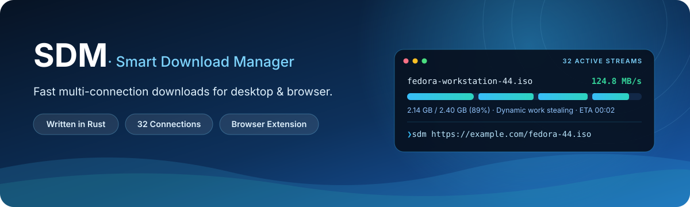

<div align="center">



<p>
  
  
  
  
</p>

**A blazing-fast, lightweight multi-connection download manager with seamless browser integration.**

[Features](#-features) · [Installation](#-installation) · [Usage & Updates](#-usage--updates) · [Browser Extension](#-browser-extension-setup) · [Shortcuts](#️-keyboard-shortcuts) · [Build from Source](#️-build-from-source) · [Architecture](#-architecture)

</div>

---

## ✨ Features

<table>
  <tr>
    <td width="50%">
      <h3>⚡ 32-Stream Parallel Engine</h3>
      <p>Saturates high-bandwidth links with up to 32 concurrent HTTP/1.1 range connections and 512 KiB positional write buffers.</p>
    </td>
    <td width="50%">
      <h3>🔄 Dynamic Work Stealing</h3>
      <p>Idle workers automatically split the largest remaining segment in half, eliminating slow straggler connections at the tail of a download.</p>
    </td>
  </tr>
  <tr>
    <td width="50%">
      <h3>💾 Crash-Safe Resume</h3>
      <p>Persists byte-exact segment progress and ETag/Last-Modified validators so interrupted transfers resume cleanly without corruption.</p>
    </td>
    <td width="50%">
      <h3>🧩 Native Browser Integration</h3>
      <p>Intercepts downloads from Chrome, Edge, Brave, and Firefox via native messaging, forwarding cookies, referers, and filenames.</p>
    </td>
  </tr>
  <tr>
    <td width="50%">
      <h3>🎨 Adaptive Desktop UI</h3>
      <p>Libadwaita-inspired Slint interface with automatic system light/dark theme switching, live sparkline graph, and queue controls.</p>
    </td>
    <td width="50%">
      <h3>🚀 Background & Self-Updating</h3>
      <p>Continues transfers silently when the window is closed and supports one-click in-app or CLI atomic self-updates (<code>sdm -U</code>).</p>
    </td>
  </tr>
</table>

---

## 📦 Installation

### Quick Install (Linux / macOS)

```sh
curl -fsSL https://raw.githubusercontent.com/rohityadav-sas/sdm/main/install.sh | sh
```

### Quick Install (Windows PowerShell)

```powershell
irm https://raw.githubusercontent.com/rohityadav-sas/sdm/main/install.ps1 | iex
```

| Platform | Default Install Path |
| :--- | :--- |
| **Linux / macOS** | `~/.local/bin/sdm` (plus `sdm-host` and browser extension bundle) |
| **Windows** | `%LOCALAPPDATA%\Programs\sdm\sdm.exe` |

<details>
<summary><b>Customizing Version or Install Directory</b></summary>

<br>

**Linux / macOS:**
```sh
curl -fsSL https://raw.githubusercontent.com/rohityadav-sas/sdm/main/install.sh | SDM_VERSION=v1.0.0 sh
```

**Windows PowerShell:**
```powershell
$env:SDM_VERSION = 'v1.0.0'; irm https://raw.githubusercontent.com/rohityadav-sas/sdm/main/install.ps1 | iex
```

Set `SDM_INSTALL_DIR` to override the target installation directory.
</details>

---

## 🚀 Usage & Updates

### Direct URL Download

Pass download URLs directly from your terminal or scripts—SDM either launches or forwards the URL to your running instance:

```sh
sdm "https://example.com/largefile.iso"
```

### Atomic Self-Update

SDM updates itself in place without losing your download history or settings:

- **Terminal**:
  ```sh
  sdm --update   # or: sdm -U
  ```
- **In-App**: Open **Preferences** (<kbd>Ctrl</kbd> + <kbd>,</kbd>) → **About & Updates** → **Check for Updates** → **Update Now**.

### Speed Benchmarking

Compare SDM head-to-head against `aria2c` and `curl`:

```sh
scripts/bench.sh "https://example.com/largefile.iso" 3
```

---

## 🧩 Browser Extension Setup

1. Launch **SDM**, open **Browser Extension** in the sidebar, and click **Set Up** (or run `sdm-host --install` in a terminal). This registers the native messaging host and unpacks the extension files.
2. **Chrome / Edge / Brave**:
   - Navigate to `chrome://extensions`
   - Enable **Developer mode** (top-right toggle)
   - Click **Load unpacked** and select the `chromium` folder inside your SDM data directory.
3. **Firefox**:
   - Navigate to `about:debugging` → **This Firefox**
   - Click **Load Temporary Add-on** and select `firefox/manifest.json`.

---

## ⌨️ Keyboard Shortcuts

| Shortcut | Action |
| :--- | :--- |
| <kbd>Ctrl</kbd> + <kbd>V</kbd> | Paste URL(s) from clipboard and start downloading immediately |
| <kbd>Ctrl</kbd> + <kbd>N</kbd> | Open the **New Download** dialog |
| <kbd>Ctrl</kbd> + <kbd>,</kbd> | Open **Preferences** |
| <kbd>Ctrl</kbd> + <kbd>Q</kbd> | Pause active transfers and quit |
| **Double-click** | Open a completed file with the system default handler |

---

## 🛠️ Build from Source

### Prerequisites

- **Rust toolchain** (1.80+): `curl --proto '=https' --tlsv1.2 -sSf https://sh.rustup.rs | sh`
- **Linux system packages**:
  - **Fedora / RHEL**: `sudo dnf install gcc fontconfig-devel`
  - **Ubuntu / Debian**: `sudo apt install build-essential libfontconfig1-dev`
  - **Arch Linux**: `sudo pacman -S base-devel fontconfig`

### Compile & Install Locally

```sh
git clone https://github.com/rohityadav-sas/sdm.git
cd sdm
cargo build --release
packaging/install.sh
```

- **Uninstall**: `packaging/uninstall.sh`
- **Build Fedora RPM**: `packaging/make-rpm.sh`

---

## 🏗️ Architecture

```text
sdm/
├── crates/engine    # Headless HTTP/1.1 multi-range engine, dynamic splitting & rate limiter
├── crates/app       # Slint desktop UI, queue scheduler, store persistence & self-updater
├── crates/ipc       # Authenticated local TCP control channel & native-host installer
├── crates/host      # Browser Native Messaging bridge (sdm-host)
├── crates/cli       # Headless CLI runner for automated benchmarking (sdm-cli)
└── extension/       # Manifest V3 (Chromium) & Manifest V2 (Firefox) WebExtension
```

See [ARCHITECTURE.md](ARCHITECTURE.md) for a deep dive into the segment-stealing algorithm, IPC protocol, and headless testing harness.

---

## 📄 License

Copyright © 2026 Rohit Yadav. Released under the [GNU General Public License v3.0](LICENSE).

<div align="center">


</div>
